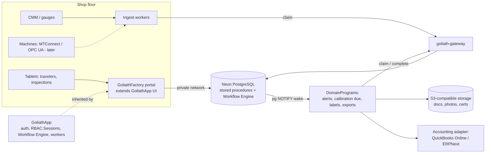

# GoliathFactory

GoliathApp specialization for manufacturing operations: work orders and signed travelers, QC inspections, lot traceability and genealogy, NCR/CAPA, inventory and purchasing, and maintenance. Initial targets are 10–50 person precision shops (AS9100, ISO 13485, ISO 9001) and food processors (FSMA 204) in Florida.

Status: **Phase 1 in development** — core schemas (`fac_eng`, `fac_prod`, `fac_trace`), semantic namespace `mfg`, Phase 1 NavTree nodes, and typed action stubs. See [`docs/plan.md`](docs/plan.md).

## Layout

| Path | Purpose |
| --- | --- |
| [`docs/plan.md`](docs/plan.md) | Full plan: domain model, inventory, workflows, DomainPrograms, schema, roles, views, roadmap, decisions |
| [`src/goliath_factory/`](src/goliath_factory/) | Python package (semantic specs, actions, seed helpers) |
| [`database/schema/`](database/schema/) | Ordered SQL apply scripts (views, RLS, semantic functions, NavTree) |
| [`scripts/apply_domain_schema.sh`](scripts/apply_domain_schema.sh) | Idempotent domain DDL apply (after GoliathApp platform schema) |
| [`.goliath/product.json`](.goliath/product.json) | GoliathWeb catalog entry |

## Quick start (developers)

```bash
python -m pip install -e ".[dev]"
goliath-factory-semantic-export --catalog schemas/semantic/catalog.json \
  -o database/schema/portal_semantic_row_types.sql
pytest -q
```

After GoliathApp platform schema is on a database:

```bash
export PGHOST=... PGDATABASE=... PGUSER=... PGPASSWORD=...
./scripts/apply_domain_schema.sh
goliath-factory-seed-semantic
goliath-factory-seed-nav
```

## Inventory (`inv`)

Item master, stock, and purchasing are implemented once in **GoliathApp** (generic `inv` module). GoliathFactory depends on that module when deployed but does not define duplicate inventory schemas or NavTree nodes here. Factory › Inventory & purchasing in the plan refers to platform `inv` nodes enabled at release time.

## Architecture



GoliathFactory inherits GoliathApp auth (`RBAC.Sessions`), the portal, the semantic registry (named requests + Exograph GraphQL/MCP) as the read API, typed `ActionSpec` actions, and workers that claim tasks through goliath-gateway. GoliathApp knows nothing about GoliathFactory; this repo registers the `mfg` namespace and domain DDL only.

See the [plan](docs/plan.md) for details.

## Related

| Product | Role |
| --- | --- |
| [GoliathApp](https://github.com/Goliath-Research/GoliathApp) | Platform (RBAC, portal shell, Workflow Engine, workers, shared `inv` module) |
| [GoliathCrop](https://github.com/Goliath-Research/GoliathCrop) | Sibling application; packhouse lots and shared inventory patterns |
| [GoliathGroundStation](https://github.com/Goliath-Research/GoliathGroundStation) | Sibling application; OPC UA experience for machine monitoring |
| [GoliathWeb](https://github.com/Goliath-Research/GoliathWeb) | Public catalog (product page) |

## License

MIT — Copyright 2026 Goliath Research.
