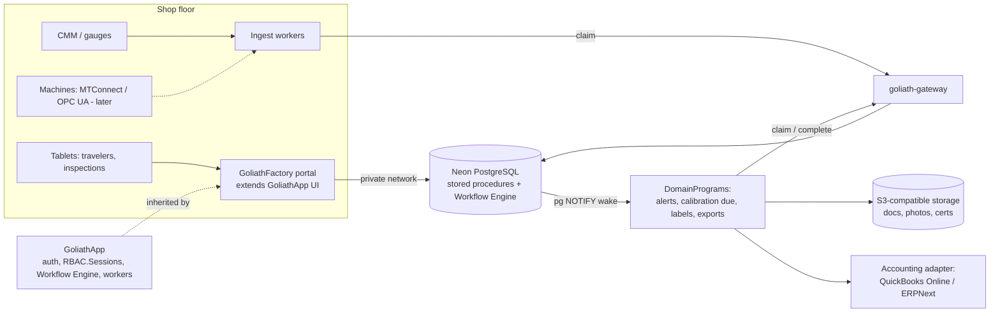

# GoliathFactory

GoliathApp specialization for manufacturing operations: work orders and signed travelers, QC inspections, lot traceability and genealogy, NCR/CAPA, inventory and purchasing, and maintenance. Initial targets are 10–50 person precision shops (AS9100, ISO 13485, ISO 9001) and food processors (FSMA 204) in Florida.

Status: **planned**. This repository currently holds the catalog entry and the plan.

## Layout

| Path | Purpose |
| --- | --- |
| [`docs/plan.md`](docs/plan.md) | Full plan: domain model, inventory, workflows, DomainPrograms, schema, roles, views, roadmap, decisions |
| [`.goliath/product.json`](.goliath/product.json) | GoliathWeb catalog entry |

## Architecture

GoliathFactory inherits GoliathApp auth (`RBAC.Sessions`), the portal, PostgreSQL stored procedures as the API, the Workflow Engine, and workers that claim tasks through goliath-gateway, with Postgres pub/sub waking workers for event-triggered tasks. Inventory and purchasing come from a shared GoliathApp module; accounting syncs through a pluggable adapter.

See the [plan](docs/plan.md) for details.

## Related

| Product | Role |
| --- | --- |
| [GoliathApp](https://github.com/Goliath-Research/GoliathApp) | Platform (RBAC, portal shell, Workflow Engine, workers, DomainPrograms) |
| [GoliathCrop](https://github.com/Goliath-Research/GoliathCrop) | Sibling application; packhouse lots and shared inventory |
| [GoliathGroundStation](https://github.com/Goliath-Research/GoliathGroundStation) | Sibling application; OPC UA experience for machine monitoring |
| [GoliathWeb](https://github.com/Goliath-Research/GoliathWeb) | Public catalog (product page) |

## License

MIT — Copyright 2026 Goliath Research.
