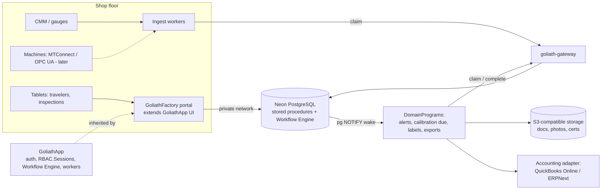

# GoliathFactory — Manufacturing Operations plan

GoliathFactory is a GoliathApp child app for travelers, QC, lot genealogy, NCR/CAPA and maintenance at 10–50 person Florida manufacturers. Phase 0 is one pilot shop, not code.

## Vision and buyer

A manufacturing-operations specialization: work orders and travelers, QC inspections, lot traceability and genealogy, nonconformances/CAPA, and maintenance, with every operator, QA and manager action typed, signed and recorded.

| Buyer | Detail | Priority |
| --- | --- | --- |
| Precision shops | 10–50 person CNC, machining and stamping shops in Florida serving aerospace and medical (AS9100, ISO 13485, ISO 9001) | Primary |
| Food processors | Packinghouses and processors needing lot traceability (FSMA 204) and audit records | Secondary |
| Not the buyer | Plants large enough for SAP, Plex or MasterControl, or that decide by committee | — |

The name is GoliathFactory: every factory includes QC, so quality is part of it, not a separate product.

## Why this specialization

- **Most workflow-shaped market.** A shop's day is travelers, inspection steps, approvals, nonconformances and audit records: typed actions by operators, QA and managers with a record kept. That is exactly what GoliathApp's Workflow Engine and RBAC do, more purely than Crop.
- **David's credibility.** GE Transportation locomotive software and hardware-in-the-loop validation, Bombardier, IQMS ERP, MISRA firmware: he talks to a shop owner as a peer who has lived their systems.
- **Dense, right-sized buyers.** Florida has many 10–50 person precision shops and food processors, too small for SAP/Plex/MasterControl pricing, big enough to pay for custom work and decide without a committee.
- **Daily, auditable pain.** AS9100/ISO 9001 audits, customer lot-genealogy demands and lost travelers hurt now, which shortens sales cycles versus a nice-to-have analytics platform.
- **Live threads.** Space Coast aerospace suppliers in Vaya's ecosystem; Dundee packinghouses and Wish's berry operation as food-traceability buyers. One specialization serves both.

## Runners-up

| Option | Verdict |
| --- | --- |
| Test operations | Generalizes the Vaya angle (campaigns, procedures, anomaly review); hold until an aerospace buyer validates it, or it is a market of one |
| Packhouse / post-harvest | Natural GoliathCrop extension using the Dundee and Wish conversations; same buyer pool, not better targets |
| Lab / sample management | Overlaps GoliathOmics; would split focus rather than open a market |

> **Discipline.** Each specialization multiplies maintenance and the scarcest resource is one real deployment. Do not build speculatively: find one shop willing to pilot around its traveler and QC flow, and let its process define v1.

## Architecture fit

| Aspect | Plan |
| --- | --- |
| Parent | GoliathApp (knows nothing about GoliathFactory) |
| Auth | Inherit GoliathApp auth and `RBAC.Sessions`; e-signature re-authentication comes from GoliathApp (work item below) |
| API | GoliathApp semantic registry (`portal.sp_run_semantic_request`, Exograph GraphQL/MCP) for reads; `ActionSpec` actions via the gateway for writes |
| Workflows | GoliathApp Workflow Engine runs travelers, NCR/CAPA, approvals; any missing engine feature is built in GoliathApp for every child |
| Accounting | Pluggable accounting adapter (QuickBooks Online, ERPNext, others) |
| Workers | Claim through goliath-gateway only; Postgres pub/sub wakes event tasks |
| Storage | Documents, photos, certs on S3-compatible storage; references in Postgres |
| Defaults | Free tools first, CPU-only workers (as GoliathCrop) |
| Status | Phase 5 complete on `main` — FSMA 204 food profile, offline tablet queue, MTConnect/OPC UA stubs; roadmap through Phase 5 shipped (`stable` in `.goliath/product.json`) |

## Users and roles

| Role | Can |
| --- | --- |
| Owner / plant manager | Everything; approve releases, CAPA closure, users |
| Production supervisor | Release work orders, assign operations, disposition holds |
| Operator | Run traveler steps, record measurements, sign off own operations |
| Quality inspector | First-article and in-process inspections, gauge use, open NCRs |
| Quality manager | Approve plans and documents, MRB disposition, CAPA, audits |
| Maintenance tech | Work PMs and repairs, log downtime |
| Buyer / storekeeper | Items, supplier items, POs, receiving, issues, counts |
| Auditor / customer (read) | Read-only certs, genealogy, audit trail for scoped lots |
| Worker (service) | Gateway claim scopes only |

## Semantic layer

Raw tables are an internal detail. Users, the portal, and agents see **GoliathFactory** through GoliathApp's semantic registry ([semantic layer](https://goliath-research.github.io/GoliathApp/semantic-layer/), [semantic extensions](https://goliath-research.github.io/GoliathApp/semantic-extensions/)), the same pattern as GoliathOmics.

- **Namespace:** `mfg` (row in `portal.semantic_namespace`; GoliathApp owns `core` and `engine`).
- **Registration:** Python `SemanticEntitySpec` / `SemanticRequestSpec` (`goliath_app.semantic.spec`) → `goliath-semantic-export` (Pydantic row models, `portal_semantic_row_types.sql`, `schemas/semantic/catalog.json`) → release seeder calling `portal.sp_semantic_register_entity`, `portal.sp_semantic_register_attribute`, `portal.sp_semantic_register_request`.
- **Reads:** every read is a named request run by `portal.sp_run_semantic_request` (RBAC permission + organization scope), via `goliath_app.portal.PortalClient` or the Exograph GraphQL/MCP façade.

### Entities

| Code | Display name | Key attributes | Backing (`storage_relation` / Meta class) |
| --- | --- | --- | --- |
| `mfg.part` | Part revision | part_number, revision, material_spec, customer, effectivity | view `fac_eng.v_part_revision` |
| `mfg.routing` | Routing | part revision, operations, work centers | view `fac_eng.v_routing` |
| `mfg.work_order` | Work order | part revision, quantity, lot, due date, status | view `fac_prod.v_work_order` |
| `mfg.traveler_step` | Traveler step | work order, operation, operator, machine, qty good/scrap, signed | view `fac_prod.v_traveler_step` |
| `mfg.inspection_plan` | Inspection plan | part revision, characteristics, sampling | view `fac_qual.v_inspection_plan` |
| `mfg.inspection_result` | Inspection result | characteristic, piece, value, pass/fail, inspector | view `fac_qual.v_inspection_result` |
| `mfg.gauge` | Gauge | gauge_id, type, location, cal_due, locked_out | view `fac_gauge.v_gauge` |
| `mfg.lot` | Lot | lot number, kind, heat/cert, parent/child links | view `fac_trace.v_lot` + `fn_genealogy` |
| `mfg.ncr` | Nonconformance | part, lot, defect, containment, disposition | view `fac_qual.v_ncr` |
| `mfg.capa` | CAPA | source NCRs, root cause, actions, effectiveness | view `fac_qual.v_capa` |
| `mfg.asset` | Maintenance asset | machine, PM schedule, next due, downtime | view `fac_maint.v_asset` |
| `mfg.document` | Controlled document | number, revision, status, approvals | view `fac_doc.v_document` |
| `mfg.item` | Item | item master, supplier items, on hand (GoliathApp `inv` module) | `inv` module entities (`inv.item`) |
| `mfg.purchase_order` | Purchase order | supplier, lines, receipts (GoliathApp `inv` module) | `inv` module entities (`inv.purchase_order`) |

### Named requests

| `request_code` | Entity | Params | `required_permission` | Target |
| --- | --- | --- | --- | --- |
| `mfg.work_order.list_open` | `mfg.work_order` | site_id, status?, due_before? | `mfg.work_order.read` | view |
| `mfg.traveler_step.by_work_order` | `mfg.traveler_step` | work_order_id | `mfg.traveler.read` | view |
| `mfg.inspection_result.by_lot` | `mfg.inspection_result` | lot_id | `mfg.quality.read` | view |
| `mfg.lot.genealogy` | `mfg.lot` | lot_id, direction (forward/backward) | `mfg.trace.read` | function `fac_trace.fn_genealogy` |
| `mfg.ncr.list_open` | `mfg.ncr` | site_id, status? | `mfg.quality.read` | view |
| `mfg.gauge.due_calibration` | `mfg.gauge` | site_id, within_days | `mfg.gauge.read` | view |
| `mfg.asset.pm_due` | `mfg.asset` | site_id, within_days | `mfg.maint.read` | view |

### Example entity spec

```python
from goliath_app.semantic.spec import SemanticAttributeSpec, SemanticEntitySpec, SemanticRequestSpec

WORK_ORDER_ENTITY = SemanticEntitySpec(
    namespace="mfg",
    code="work_order",
    display_name="Work order",
    description="A released or planned production order with its traveler.",
    schema_version="1",
    row_model=WorkOrderRow,
    storage_relation="fac_prod.v_work_order",
    attributes=(
        SemanticAttributeSpec(code="work_order_id", column_name="id", json_type="integer", role="key"),
        SemanticAttributeSpec(code="site_id", column_name="site_id", json_type="integer", role="filter", filterable_ops=("eq",)),
        SemanticAttributeSpec(code="part_number", column_name="part_number", json_type="string", role="label", filterable_ops=("eq", "ilike")),
        SemanticAttributeSpec(code="status", column_name="status", json_type="string", role="attribute", filterable_ops=("eq", "in")),
        SemanticAttributeSpec(code="due_date", column_name="due_date", json_type="date", role="attribute", filterable_ops=("lte", "gte")),
    ),
)

WORK_ORDER_LIST = SemanticRequestSpec(
    request_code="mfg.work_order.list_open",
    version="1",
    namespace="mfg",
    entity_code="work_order",
    target_kind="view",
    target_name="fac_prod.v_work_order",
    params_model=WorkOrderListParams,
    result_row_model=WorkOrderRow,
    required_permission="mfg.work_order.read",
    max_rows=500,
)
```

## Action layer

Business operations are typed `ActionSpec` rows (`goliath_app.actions.spec`), published through the `goliath.action_catalogs` entry point and synced into `wf.workflow_action` by the release (`seed_action_catalog.py --use-db`). Levels: `engine` = low-level workflow steps (GoliathApp), `core` = GoliathApp core-entity actions, `domain` = GoliathFactory business actions. Every user-facing action uses `exposure=ActionExposure.RBAC` and names its `entity_code`; internal helper steps use `ActionExposure.HIDDEN`.

| `action_name` | Level | `entity_code` | Exposure | `required_permission` | Capability |
| --- | --- | --- | --- | --- | --- |
| `mfg.work_order.release` | domain | `mfg.work_order` | RBAC | `mfg.work_order.release` | `mfg.prod` |
| `mfg.traveler_step.sign_off` | domain | `mfg.traveler_step` | RBAC | `mfg.traveler.sign` | `mfg.prod` |
| `mfg.inspection_result.record` | domain | `mfg.inspection_result` | RBAC | `mfg.quality.inspect` | `mfg.quality` |
| `mfg.ncr.open` | domain | `mfg.ncr` | RBAC | `mfg.quality.inspect` | `mfg.quality` |
| `mfg.ncr.disposition` | domain | `mfg.ncr` | RBAC | `mfg.quality.mrb` | `mfg.quality` |
| `mfg.capa.close` | domain | `mfg.capa` | RBAC | `mfg.quality.approve` | `mfg.quality` |
| `mfg.gauge.lockout_check` | domain | `mfg.gauge` | HIDDEN | — | `mfg.gauge` |
| `mfg.lot.coc_generate` | domain | `mfg.lot` | RBAC | `mfg.trace.write` | `mfg.trace` |

### Example ActionSpec

```python
from goliath_app.actions.spec import ActionExposure, ActionLevel, ActionSpec

DISPOSITION = ActionSpec(
    action_name="mfg.ncr.disposition",
    namespace="mfg",
    level=ActionLevel.DOMAIN,
    entity_code="ncr",
    display_name="Disposition NCR",
    description="Record MRB disposition (use-as-is, rework, scrap, RTV) with e-signature.",
    exposure=ActionExposure.RBAC,
    required_permission="mfg.quality.mrb",
    input_model=NcrDispositionInput,
    output_model=NcrDispositionOutput,
    schema_version="1",
    capability="mfg.quality",
    tool="mfg-ncr",
)
```

```toml
# pyproject.toml
[project.entry-points."goliath.action_catalogs"]
mfg = "goliath_factory.actions.catalog:ACTIONS"
```

## NavTree extension

GoliathFactory **adds** nodes to `portal."NavTree"` with `portal.sp_nav_register_node(p_parent_id, p_caption, p_seq, p_info_id, p_node_path, p_sort_path)` and grants them in `portal."Role2Node"` (`ScopeId`, `RoleId`, `NodeId`). It never updates or deletes GoliathApp foundation nodes (home, organizations, users and roles, workflows, admin); it only attaches a top-level **Factory** node beside them and children under it. Captions stay within `varchar(50)`. Each leaf's `InfoID` points to the entity, request, or action it opens.

| Node path | Opens | Roles (`Role2Node`) |
| --- | --- | --- |
| Factory | group node beside foundation menus | all factory roles |
| Factory › Work orders | `mfg.work_order.list_open`; action `mfg.work_order.release` | plant manager, supervisor |
| Factory › Shop floor (traveler) | `mfg.traveler_step.by_work_order`; action `mfg.traveler_step.sign_off` | operator, supervisor |
| Factory › Quality › Inspections | `mfg.inspection_result.by_lot`; action `mfg.inspection_result.record` | inspector, quality manager |
| Factory › Quality › NCR / CAPA | `mfg.ncr.list_open`; actions `mfg.ncr.disposition`, `mfg.capa.close` | quality manager, supervisor |
| Factory › Gauges | `mfg.gauge.due_calibration` | inspector, quality manager |
| Factory › Traceability | `mfg.lot.genealogy`; action `mfg.lot.coc_generate` | quality manager, auditor (read) |
| Factory › Maintenance | `mfg.asset.pm_due` | maintenance tech, plant manager |
| Factory › Inventory & purchasing | GoliathApp `inv` module nodes (enabled, not redefined) | buyer / storekeeper |

Role2Node rows are scoped per organization (`ScopeId`); the release seeder inserts them idempotently after the nodes exist. Foundation menus remain exactly as GoliathApp ships them.

## Reuse of GoliathApp

| Concern | Comes from GoliathApp | GoliathFactory adds |
| --- | --- | --- |
| Organizations and tenancy | `portal."Organizations"`, `portal.fn_semantic_user_organization_ids` | Site belongs to an organization; site-level scoping via request filters |
| RBAC | `RBAC` roles, `"RBAC"."UserRoleGrants"`, `"RBAC"."Role_Permissions"`, sessions | `mfg.*` permissions and role bundles |
| Audit and e-signature | Platform append-only audit and signature service | Domain meanings for signatures |
| Read API | `portal.sp_run_semantic_request`, `PortalClient`, Exograph GraphQL + optional MCP (`goliath_portal` role, read-only) | Registry rows only |
| Writes | REST gateway → `wf.sp_*` / `portal.sp_*` ops and `ActionSpec` actions | Domain actions |

There is no per-app "stored procedures are the API" surface: internal domain procedures exist only as `target_name` of semantic requests or as action handlers.

## Inventory & Purchasing

> **Build once in GoliathApp.** GoliathCrop (seed, fertilizer, chemicals) and GoliathOmics (reagents, kits) need the same thing. A generic, domain-neutral inventory/purchasing module in GoliathApp that knows nothing about child apps; GoliathFactory, Crop and Omics each extend it with their own item attributes and rules.

| Area | What it covers |
| --- | --- |
| Item master | One internal item: internal part number, description, base unit, category, make/buy, lot/serial control, shelf life |
| Supplier items | Supplier part number and name/description, MPN (distributor vs manufacturer), pack size and unit conversion, price breaks with effective dates and currency, lead time, MOQ, preferred/approved flag |
| Approved Supplier List | AS9100 ASL; supplier items only purchasable from approved suppliers |
| Customer cross-refs | Optional customer part numbers per item |
| Alternates | Equivalent items; substitution needs a signed approval in regulated work |
| Stock | Locations/bins, on-hand by lot, reservations, adjustments, cycle counts, reorder points |
| Purchasing | Simple POs and receipts; receiving with incoming inspection feeding QC/NCR |
| Issue to work order | Consumes lots onto the traveler, feeding genealogy |
| Costing | Moving average default, standard optional; FIFO lot cost later |
| Catalog / invoice matching | Import supplier catalogs and invoices with different names; fuzzy match to the item master with a human confirmation queue |

## Workflows on the Workflow Engine

| Workflow | Typed actions |
| --- | --- |
| Work order release | Create from routing → review → release → print traveler/labels |
| Traveler execution | Start op → record qty/measurements → sign off → next op or hold |
| First article (AS9102) | Plan → measure all characteristics → QA approve → release run |
| In-process / final inspection | Sample → measure → pass, or auto-open NCR on fail |
| NCR / MRB | Open → contain → disposition (signed) → close or escalate to CAPA |
| CAPA | Root cause → action plan → implement → verify effectiveness → close |
| Gauge calibration | Due → pull from service → calibrate/attach cert → return or retire |
| Preventive maintenance | Due → assign → complete checklist → sign → next due |
| Document change | Draft → review → approve (signed) → effective → retrain |
| Shipment / CoC | Final QC → genealogy check → certificate of conformance → ship |
| Purchase and receive | Reorder suggestion → PO (approved supplier) → receive lot → incoming inspection → accept to stock or NCR |
| Issue to work order | Reserve → pick lot from bin → issue to traveler step (genealogy link) |
| Substitution | Request alternate item → QA/engineering approve (signed) → issue |
| Cycle count | Generate count → count bin → variance review → signed adjustment |

## Workers and DomainPrograms

| Program | Activation | Trigger |
| --- | --- | --- |
| Calibration / PM due scan | Claim | Daily backlog |
| Out-of-tolerance alert | Wake + claim | Inspection result inserted out of spec |
| NCR notification / escalation | Wake + claim | NCR opened or overdue |
| Label and traveler printing | Wake + claim | Work order released, lot created |
| CMM / gauge import | Wake + claim | Result file uploaded or gauge push |
| CoC / genealogy report | Claim | User request queued |
| Accounting adapter sync | Claim | Scheduled backlog |
| SPC summaries | Claim | Nightly backlog |
| Reorder point scan | Claim | Daily backlog |
| Catalog / invoice matching | Wake + claim | File uploaded; fuzzy matches go to a human confirmation queue |

Same pattern as GoliathCrop: a stored procedure inserts the task and issues `pg_notify`; idle workers wake, then own it with a gateway claim. All CPU-only.

## Portal and shop-floor views

1. Shop-floor traveler (tablet): current step, instructions, record and sign, big touch targets
2. Inspection entry: characteristic list with tolerance bands, gauge scan, pass/fail
3. Work order board: released, in progress, on hold, by work center
4. Lot genealogy: forward and backward trace tree with certs
5. NCR/CAPA queue and MRB review
6. Gauge and PM calendars with due/overdue
7. Inventory: items with supplier items and prices, stock by bin/lot, receiving (tablet), POs, cycle counts, match-confirmation queue
8. Document control and approvals
9. Audit trail viewer and audit-ready export

## Integrations

- **Accounting / ERP adapter.** One adapter interface: customers, vendors, items, sales orders and invoices, POs, receipts, vendor bills, payments. Adapters: QuickBooks Online, ERPNext; IQMS/others by pilot need. If the pilot's ERP owns inventory, sync it instead of duplicating.
- **Supplier catalogs and invoices.** CSV/PDF import into the matching queue; distributor catalogs carry MPNs.
- **CMM and gauges.** CSV/DMIS/Q-DAS file import; USB/Bluetooth gauge input on tablets.
- **Label printing.** ZPL to Zebra printers for lot, traveler and gauge labels.
- **Machine monitoring (later).** MTConnect and OPC UA, reusing GoliathGroundStation's OPC UA experience.
- **Ecosystem.** GoliathCrop for packhouse lots; standalone utilities stay unaware of GoliathApp.

## Architecture diagram



## Roadmap

1. **Phase 0 — Find the pilot (no code).** Walk 5–10 shops via Vaya's Space Coast network and the Dundee/Wish threads; pick one; map its paper traveler, inspection and NCR flow; agree on v1 scope and a discounted first-buyer price (never free). Aerospace/medical or food, whichever answers first.
2. **Phase 0b — GoliathApp prerequisites.** Human task/approval step, e-signatures and a generic audit trail in GoliathApp (see Workflow Engine findings), plus the shared `inv` module, usable by every child app.
3. **Phase 1 — Repo and core data.** Public MIT repo, `.goliath/product.json`, GoliathWeb page; parts/routings/work orders/lots schemas shaped by the pilot; generic `inv` module in GoliathApp (items, supplier items, locations, stock lots).
4. **Phase 2 — Pilot v1.** Tablet traveler, inspection entry, receiving with incoming inspection, issue to work order, lot genealogy, NCR, audit trail and e-signatures, label printing; run alongside paper.
5. **Phase 3 — Quality and purchasing.** CAPA, gauge calibration, document control, FAI (AS9102), CoC export; POs, ASL, price breaks, reorder points, cycle counts, costing, catalog/invoice matching, accounting adapter (QuickBooks Online and ERPNext).
6. **Phase 4 — Maintenance and SPC.** Assets, PMs, downtime, SPC charts, CMM import.
7. **Phase 5 — Second customer and beyond.** Food-processor profile (FSMA 204), offline tablet mode, MTConnect/OPC UA machine monitoring, other ERPs.

Pilot criteria:

- [ ] 10–50 people, AS9100/ISO 9001/13485 or FSMA exposure
- [ ] Paper or spreadsheet travelers today, real pain (audit finding, lost traveler, genealogy request)
- [ ] Owner or quality manager who decides and gives weekly access
- [ ] Pays a discounted first-buyer build (never free) and agrees to be a reference
- [ ] Shop-floor Wi-Fi at the stations that will use tablets
- [ ] Within driving distance in Florida

## Risks

| Risk | Mitigation |
| --- | --- |
| Building for nobody | No code before a signed pilot |
| Compliance claims | Part 11 / AS9100 support is controls plus the shop's procedures; never claim certification. Validate e-signature design early |
| Shop-floor adoption | Operators reject slow screens; tablet-first, assume shop Wi-Fi for v1 (offline mode later), pilot alongside paper |
| Scope creep into ERP/MES | Stay quality and traceability; integrate with ERP rather than replace it |
| Maintenance load | Another child app to keep current with GoliathApp; keep domain logic in stored procedures and workflows |

## Decisions

| Question | Decision |
| --- | --- |
| 1. First shops and introducers | Depends on replies from the prospects; does not change the plan |
| 2. Aerospace/medical or food first | Both are targets; little impact on plan or implementation |
| 3. Pilot commercial shape | Discounted build for the first buyer, never free |
| 4. Workflow Engine readiness | Conditions exist; human approval, e-signature and audit gaps are GoliathApp work items (below) |
| 5. E-signature scope | AS9100 records in v1 with Part 11-style controls built in (re-auth, signature meaning, signer, time, linked hash); formal Part 11 validation only when a medical/food buyer requires it |
| 6. Offline tablets | Assume shop Wi-Fi; offline tablet mode later (Phase 5) |
| 7. Accounting | Pluggable accounting adapter; free option preferred (below) |
| 8. Name | GoliathFactory; every factory includes QC, GoliathQuality dropped |
| 9. Inventory module location | Recommendation: a GoliathApp-owned optional module (own `inv` schema and stored procedures, domain-neutral) that a child app enables, not always-on core |
| 10. Default costing | Recommendation: moving average by default, standard cost optional per item; FIFO lot cost later, only if a buyer needs it |

### Workflow Engine findings

Checked in Goliath-Research/GoliathApp `main` (read-only).

| Exists | Where |
| --- | --- |
| IF / SWITCH / WHILE nodes branch on scope variables set by earlier action outputs | `workflow_engine/sql_pg/03_engine_core.sql`, `workflow_engine/contract/workflow_definition_spec.py` (`condition_var`, `condition_expr`), `docs/workflow-compiler.md` |
| WAIT_EVENT node parks an instance until a matching event arrives (`signal_wait`) | `workflow_engine/sql_pg/wf_event_plane.sql`, `wf.sp_ingest_event` / `wf.sp_signal_wait` in `workflow_engine/contract/db_objects.md`, `docs/workflow-engine.md` |
| Approval rows only for RBAC bypass-scope roles | `portal.sp_*_bypass_scope_approval` in `workflow_engine/sql_pg/rbac_api_parity.sql`, `docs/rbac.md` |
| Instance extension for optional domain audit metadata; onboarding-only AuditLog | `workflow_engine/sql_pg/00_schema.sql`, `workflow_engine/sql_pg/onboarding_schema.sql` |

Conditional steps work: an action sets a variable and IF branches on it. A conditional approval can be built today as IF → WAIT_EVENT → event from the portal. What is missing is a first-class human step. GoliathApp work items:

- [ ] Human task / approval step (assignee role, inbox, approve/reject outcome, due time and escalation) on top of WAIT_EVENT
- [ ] E-signature service (re-auth, meaning, signer, time, record hash) callable from any step
- [ ] Generic append-only audit trail for domain records and workflow actions
- [ ] Portal API to list and act on pending human tasks, scoped by RBAC

### Accounting adapter

| Option | Fit for a small US manufacturer |
| --- | --- |
| ERPNext (Frappe) | Free, GPL; full GL, AP/AR, US taxes, multi-currency; REST API. Has manufacturing too, so use it for accounting only |
| Odoo Community | Free, LGPL; JSON-RPC API; full accounting reports are mostly in paid Enterprise |
| Akaunting | Free, GPL; REST API; simple invoicing and bills, light for AP/inventory costing |
| GnuCash | Free desktop app; no server API, not a fit for sync |
| QuickBooks Online | Paid; what David and most shops already use; good REST API |

**Recommendation:** build the adapter interface with QuickBooks Online first, since the pilot shop most likely already runs it, and ERPNext as the first free adapter for buyers with no accounting system.

## Appendix: physical mapping (internal)

These schemas back the semantic entities above. They are not a public API: the portal, Exograph, and agents reach them only through registered semantic requests and `ActionSpec` actions.

| Schema | Key tables |
| --- | --- |
| `fac_eng` | parts, part_revisions, routings, routing_operations, work_centers |
| `fac_prod` | work_orders, travelers, traveler_steps, operation_records |
| `fac_qual` | inspection_plans, characteristics, inspection_results, ncrs, mrb_dispositions, capas |
| `fac_gauge` | gauges, calibrations, calibration_certs |
| `fac_trace` | material_lots, lots, lot_links (genealogy), shipments, cocs |
| `fac_maint` | assets, pm_schedules, maintenance_orders, downtime_events |
| `fac_doc` | documents, document_revisions, approvals, training_records |
| `fac_audit` | audit_log (append-only), signatures |
| `inv` (GoliathApp module) | items, units, unit_conversions, suppliers, approved_suppliers, supplier_items, price_breaks, item_alternates, customer_item_refs, locations, bins, stock_lots, stock_moves, reservations, cycle_counts, purchase_orders, po_lines, receipts, item_costs, match_candidates |

Row-level security by site and role. Genealogy queries use recursive CTEs; no extra extensions required for v1.
